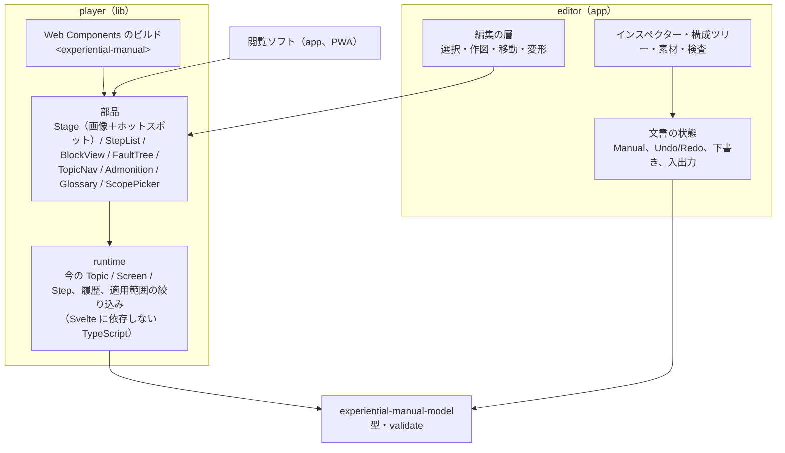
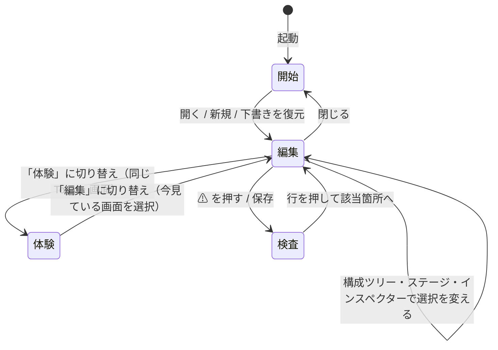

# 閲覧部品（player）と作成ツール（editor）の画面設計（草案）

体験型操作マニュアルを**見る**ための部品（player）と、その上に**作る**機能を重ねた作成ツール（editor）の画面設計の草案です。既存の試作 `app/manual-editor`（0.1.0）は「JSON を編集できること」を確かめるためのもので、設計はここで改めてやり直します。試作から残すものと捨てるものは 7 節に書きます。

- 作成日: 2026-11-07（JST）
- 前提: [notes/editor-and-viewer-study.md](../notes/editor-and-viewer-study.md)（候補のツールと構成案）、[design/manual-model.md](https://github.com/shuji-bonji/s1000d-stack/blob/main/docs/design/manual-model.md)、D-01・D-09・D-28
- 対象: player（`manual-editor/packages/player`、仮称。置き場所は 8 節）と editor（`manual-editor`、仮称）。CLI と取り込み拡張はこの文書の対象外

## 1. player を先に作り、editor を編集モードとして重ねる

「player を先に作り、そこから編集モードを作る」方針を採ります。理由は 4 つです。

| 理由 | 内容 |
|---|---|
| 描画と座標変換が 1 か所になる | 画像の表示縮尺に合わせた `coords` の変換、ホットスポットの当たり判定、多角形の描き方は、見るときも作るときも同じです。試作では `Player.svelte` と `HotspotCanvas.svelte` が別々に持っていて、片方を直すと片方がずれます |
| 作りながら見られる | 編集中の画面がそのまま利用者に見える形になります（WYSIWYG）。「編集」と「体験」を同じステージの切り替えにできます |
| player 単体が成果物になる | 閲覧ソフト、他サイトへの埋め込み（Web Components）、学習サイトのデモは player だけで成立します。editor が未完成でも出せます |
| テストが共有できる | player の「ホットスポットを押すと遷移する」「適用範囲を選ぶと節が消える」のテストが、editor の体験モードのテストになります |

editor が player に求めるものは次の 3 つだけにし、player 側に編集の知識を入れません。

1. **ステージの上に重ねる層（overlay）**: player が描く画像と同じ座標系で、editor が選択枠・ハンドル・作図中の図形を描ける場所。
2. **座標変換の公開**: 画面上の座標 ↔ 画像の座標（`toImage(x, y)` / `toScreen(x, y)`）。
3. **選択と操作の通知**: ホットスポットを押した・画面が変わった・手順を選んだ、をイベントで外に出す。編集モードでは「押しても遷移せず、選択になる」を editor 側が決める。



`runtime` を Svelte に依存しない TypeScript にするのは、CLI の `build`（静的サイトに束ねる）や将来の WebMCP（AI が「次はどの画面か」を聞く）から、画面を描かずに同じ状態遷移を使うためです。

## 2. player の画面

player は 1 冊の `Manual` を受け取り、Topic の種類（`kind`）ごとに表示を切り替えます。埋め込み（他サイトの中）と単体（閲覧ソフト）の 2 つの使われ方があるので、**外枠（目次・ヘッダー）と中身（Topic の表示）を分けます**。埋め込みでは中身だけを出せます。

### P-0 外枠（閲覧ソフト・単体のとき）

```text
┌──────────────────────────────────────────────────────────────┐
│ マニュアルの題名            版 1.2（2026-11-01）  [適用範囲 ▾] [用語集] [🔍] │
├──────────────┬───────────────────────────────────────────────┤
│ 目次         │                                               │
│ ▸ 乗車券を買う │   ← 選んだ Topic の中身（P-1〜P-4）            │
│ ▸ 定期券を買う │                                               │
│   チャージする │                                               │
│ ▸ 困ったとき   │                                               │
│              │                                               │
└──────────────┴───────────────────────────────────────────────┘
```

| 要素 | 内容 |
|---|---|
| 目次 | `Manual.topics` の順。`kind` の印（画面遷移・手順・説明・困ったとき）を付ける。狭い画面ではドロワーに畳む |
| 適用範囲 | `Manual.scopes` から `property` ごとに値を選ぶ。選ぶと `scopeRefs` が合わない Topic・Step・Block・Screen が消える（S1000D の適用性と同じ考え方。判定は `runtime` が行う） |
| 用語集 | `Manual.glossary` の一覧。本文中の語に下線を付けてポップオーバーで出すのは後の版 |
| 検索 | Topic の題名・手順の文・画面の説明を対象にした簡単な絞り込み（Pagefind のような索引は持たない） |

### P-1 画面遷移（`kind: screenFlow`）

2021 年の作品と同じ体験です。ここが player の中心になります。

```text
┌──────────────────────────────────────────────────────────────┐
│ 乗車券を買う                       STEP1 › STEP2 › [STEP3]     │  ← 通った画面の列（パン屑）
├──────────────────────────────────┬───────────────────────────┤
│                                  │ STEP3 金額を選ぶ            │
│   ┌────────────────────────┐     │                           │
│   │                        │     │ 行きたい駅までの金額の        │
│   │   画面の画像            │     │ ボタンを押します。           │
│   │   ┌────┐  ┌────┐       │     │                           │
│   │   │180 │  │220 │ ←ホット │     │ ⚠ 注意                    │
│   │   └────┘  └────┘  スポット│     │ お釣りは……                 │
│   │                        │     │                           │
│   └────────────────────────┘     │ 押せる場所（3）             │
│                                  │ ・180 円 → STEP4           │
│                                  │ ・220 円 → STEP4           │
│                                  │ ・とりまどし → STEP1        │
├──────────────────────────────────┴───────────────────────────┤
│ [← 戻る]  [最初から]                    [ヒントを表示 ☐]        │
└──────────────────────────────────────────────────────────────┘
```

| 要素 | 内容 |
|---|---|
| ステージ | `Screen.assetRef` の画像を、枠に収まる最大の縮尺で表示する。ホットスポットは `coords`（画像の座標）を縮尺で変換して SVG で重ねる。既定では見えず、ホバーかフォーカスで枠が出る。「ヒントを表示」で全部の枠を薄く出す |
| 右の欄 | `Screen.caption` / `description` / `admonitions`。「押せる場所」の一覧はホットスポットと同じ順で、キーボードだけでも進めるようにする（アクセシビリティ。試作の `HotspotCanvas` が Tab と Enter で動く方針を引き継ぐ） |
| 遷移 | `Hotspot.transition.to` へ移る。`condition` が付いたものは、押したときに「残高が不足しているとき／足りているとき」のように選択肢を出す（`when` の機械判定は適用範囲の選択で値が決まるときだけ自動にする） |
| `action` | `press` は押せる。`input` は押すと入力欄の見本（文字を入れる体験）を出す。`read` は押しても遷移せず説明だけ出す |
| 戻る・最初から | `runtime` の履歴。`startScreenRef` に戻る |
| 狭い画面 | 右の欄をステージの下に回す。タブレット（区分 B の利用者）はこの形 |

### P-2 手順（`kind: procedure`）

```text
┌──────────────────────────────────────────────────────────────┐
│ フィルターを交換する                              適用: MV-50   │
├──────────────────────────────────────────────────────────────┤
│ 1  電源を切る                                    [図]          │
│    → 表示が消える                                              │
│ 2  前面のカバーを外す                                          │
│    ⚠ 警告 手を挟まないこと                                     │
│    2.1  左右のネジを緩める                        [図]          │
│    2.2  カバーを手前に引く                                      │
│ 3  フィルターを引き出す                                        │
│    ◇ 汚れがひどいとき → 手順 5 へ / それ以外 → 手順 4 へ         │
└──────────────────────────────────────────────────────────────┘
```

- 番号は `numberSteps` で表示時に組み立てる。`expected` は「→」で、`admonitions` は手順の直下に出す。
- `assetRefs` の図は右に小さく出し、押すと拡大する。図が `Screen` を指すときは、その画面を P-1 のステージで開く（手順と画面遷移をつなぐ）。
- `next` の分岐は手順の末尾に選択肢で出し、選ぶと行き先の手順へスクロールして印を付ける。
- 「1 つずつ進める」モード（今の手順だけを大きく出し、「次へ」で進む）を持つ。現場でタブレットを見ながら作業する区分 B の使い方。

### P-3 説明（`kind: description`）

`blocks` を見出し・段落・箇条書き・表・図・注意書きとして上から出すだけです。`Block.scopeRefs` で消える段落に対応します。

### P-4 困ったとき（`kind: troubleshooting`）

```text
┌──────────────────────────────────────────────────────────────┐
│ 画面が点かない                                                 │
├──────────────────────────────────────────────────────────────┤
│  Q. 電源ランプは点いていますか？                                │
│     [ はい ]   [ いいえ ]                                       │
│  ─────────────────────────────                                 │
│  （「いいえ」を選んだとき）                                      │
│  Q. 電源プラグは差さっていますか？                               │
│     [ はい ]   [ いいえ ]                                       │
│  ─────────────────────────────                                 │
│  → 対処: プラグを差し直してください。[手順「電源を入れる」へ]      │
└──────────────────────────────────────────────────────────────┘
```

`Step.question` と `answers[].next` を上から順に追う形にします。選んだ答えの列が履歴になり、「戻る」で 1 つ前の問いに戻ります。行き先が `procedure` の手順なら P-2 を開きます。

### 埋め込み（Web Components）

```html
<experiential-manual src="./help/manual.json" topic="buy-ticket" lang="ja" hints></experiential-manual>
```

| 属性 | 内容 |
|---|---|
| `src` | manual-model の JSON の URL。画像は JSON の場所からの相対パス |
| `topic` | 最初に開く Topic の `id`。省くと目次（P-0）を出す |
| `screen` | 最初に開く Screen の `id`（ヘルプの該当箇所から直接開くため） |
| `scope` | 適用範囲の初期値（`model=MV-50` の形） |
| `hints` | ホットスポットの枠を最初から出す |
| `chrome="none"` | 外枠（目次・ヘッダー）を出さず、中身だけを出す |

## 3. editor の画面

editor は player の上に 3 つを重ねたものです。**左に構成ツリー、中央に player のステージ（編集モード）、右にインスペクター**の 3 列を基本にし、素材と検査は下の引き出しに置きます。

```text
┌──────────────────────────────────────────────────────────────────────────────┐
│ [開く][保存][名前を付けて保存]  ↶ ↷   ● 券売機の使い方  [編集 | 体験]  ⚠ 3 件  [⚙]   │
├────────────────┬───────────────────────────────────────────┬─────────────────┤
│ 構成            │ STEP3 金額を選ぶ            [□][○][⬠][↖][✋]│ インスペクター     │
│ ▾ 乗車券を買う   │                                           │ ホットスポット     │
│   ▾ 画面 (6)    │  ┌─────────────────────────────────┐      │ ラベル [180 円 ] │
│     STEP1 ●     │  │                                 │      │ 形 rect          │
│     STEP2       │  │   画面の画像                     │      │ 座標 [120][340]  │
│   ▸ STEP3 ◀    │  │   ┌────┐ ┌────┐                 │      │     [220][400]  │
│     STEP4       │  │   │180 │ │220 │                 │      │ 操作 (●押す ○入力 ○読む)│
│     STEP5       │  │   └─┬──┘ └────┘                 │      │ 遷移先 [STEP4 ▾]  │
│     STEP6 ⚠     │  │     └ 選択中（ハンドル 8 つ）     │      │ 条件 [         ] │
│ ▸ 定期券を買う   │  │                                 │      │ 適用範囲 ☐ MV-50 │
│ ▸ 困ったとき     │  └─────────────────────────────────┘      │                 │
│ [+ Topic]       │  この画面の説明 [行きたい駅までの金額の…  ]    │ [削除]           │
│                 │  注意 ⚠ [お釣りは…               ] [+]    │                 │
├────────────────┴───────────────────────────────────────────┴─────────────────┤
│ ▸ 素材 (12)   ▸ 遷移の地図   ▸ 検査 ⚠ 3                                        │
└──────────────────────────────────────────────────────────────────────────────┘
```

### E-0 共通の枠

| 要素 | 内容 |
|---|---|
| ファイル | 開く（manual-model の JSON、2021 年の JSON、画像フォルダー）、保存、名前を付けて保存。File System Access API が無ければダウンロード。下書きは `localStorage`（試作と同じ） |
| Undo / Redo | 文書の操作すべて。試作の `ops.ts`（純粋な操作関数）を引き継ぐ |
| 編集 ｜ 体験 | 同じステージで切り替える。体験に切り替えても今の Topic・画面は変えない。体験中にホットスポットを押すと遷移し、編集に戻すとその画面が選ばれている（「この遷移先の画面を直したい」を 1 回の切り替えで行う） |
| ⚠ の件数 | `validateManual` の `errors` ＋ `warnings` の数。押すと下の「検査」が開く |
| 構成ツリー | Topic › 画面（または手順）の 2 段。ドラッグで並べ替え。印: ● 開始画面、⚠ 問題あり、◀ 選択中。ツリー・ステージ・インスペクターの選択は常に同じ 1 つを指す |
| インスペクター | 選んでいるもの（Topic / 画面 / ホットスポット / 手順 / 注意 / 素材）に応じて欄が変わる |
| 下の引き出し | 素材、遷移の地図、検査。1 つだけ開く。高さはドラッグで変える |

### E-1 画面遷移の編集（`screenFlow`）

ステージは player の P-1 を編集モードで表示したものです。右の「押せる場所」の欄は出さず、代わりに作図ツールが付きます。

| ツール | 操作 |
|---|---|
| □ 矩形 / ○ 円 / ⬠ 多角形 | ドラッグで描く。多角形は点を順に置き、最初の点か Enter で閉じる。描いた直後にインスペクターの「ラベル」にフォーカスが移る |
| ↖ 選択 | ホットスポットを押して選ぶ。ハンドル 8 つで変形、中をドラッグで移動。Shift で縦横比を保つ。矢印キーで 1 px（Shift で 10 px）動かす。Delete で消す（確認は Undo で代える） |
| ✋ 手のひら | ステージの拡大縮小とスクロール（細かい座標を合わせるため）。ホイールで拡大縮小、Space を押しながらドラッグで移動 |
| 遷移先の指定 | インスペクターのプルダウンに加え、ホットスポットの右上の小さな丸を構成ツリーの画面へドラッグしてつなぐ。遷移先の画面が無いときは「新しい画面を追加して遷移先にする」を同じプルダウンに置く（撮った順に画面を足していく作業を止めない） |
| 画面の説明・注意 | ステージの下に、`caption` / `description` / `admonitions` の欄を常に出す（インスペクターに隠さない。文を書く頻度が高い） |
| 画像の差し替え | 画面を選んだときのインスペクターに「画像を差し替える」。差し替え後、新しい画像の大きさが違えば座標を縮尺で変換するかを聞く（「直す」工程のため） |

### E-2 手順の編集（`procedure`）

```text
┌────────────────┬───────────────────────────────────────────┬─────────────────┐
│ 構成            │ フィルターを交換する                          │ 手順 2.1          │
│ ▾ フィルター交換 │ 1  [電源を切る                    ]  ⋮      │ 文 [左右のネジを…]│
│   1 電源を切る   │    → [表示が消える                 ]        │ 結果 [         ] │
│   2 カバーを外す │ 2  [前面のカバーを外す              ]  ⋮      │ 図 [ねじ.jpg ▾][+]│
│     2.1 ネジ ◀  │    ⚠ [手を挟まないこと             ]        │ 注意 [+ 警告 ▾]  │
│     2.2 引く    │    2.1 [左右のネジを緩める          ]  ⋮      │ 分岐 [+ 行き先]  │
│   3 引き出す    │    2.2 [カバーを手前に引く          ]  ⋮      │ 適用範囲 ☐ MV-50 │
│                 │ 3  [フィルターを引き出す            ]  ⋮      │                 │
│                 │ [+ 手順]                                   │ [削除]           │
└────────────────┴───────────────────────────────────────────┴─────────────────┘
```

- 中央は player の P-2 と同じ見た目で、文がそのまま入力欄になっている（その場で書く）。Enter で次の手順を足し、Tab で 1 段下げ、Shift+Tab で上げる（アウトライナーの操作）。
- `expected` と `admonitions` は手順の行の中に出し、空なら薄く「結果を書く」と表示する。
- 図（`assetRefs`）は素材の引き出しからドラッグして手順に落とす。`Screen` を指すこともできる（手順の中で「この画面で押す」を結ぶ）。

### E-3 説明の編集（`description`）

`blocks` を見出し・段落・箇条書き・表・図・注意の 6 種から選んで足す、簡単なブロック編集です。Markdown 風の記法（`#`、`-`、`|`）を貼り付けると `blocks` に分解する機能を後の版で考えます。

### E-4 困ったときの編集（`troubleshooting`）

問いと答えの木を E-2 と同じアウトライナーで編集します。答えの行き先（`answers[].next.to`）は E-1 と同じプルダウンで、手順の `Step.id` か `Screen.id` を選びます。

### E-5 遷移の地図（下の引き出し）

```text
┌──────────────────────────────────────────────────────────────┐
│ 乗車券を買う の遷移                                  [整列][拡大]│
│                                                              │
│   [STEP1] ──180円──▶ [STEP2] ──▶ [STEP3] ──▶ [STEP4]         │
│      ▲                 │                        │            │
│      └────とりけし──────┘                        ▼            │
│                                            [STEP5] ⚠ 到達不可 │
└──────────────────────────────────────────────────────────────┘
```

Topic の画面をノード、`Hotspot.transition` を辺にした図です。到達できない画面（`validateManual` の警告）と、遷移先が無いホットスポットを赤く出します。ノードを押すとその画面を開きます。配置は自動（階層配置）で、位置は保存しません。2021 年の作品の 79 画面・212 ボタンの規模で、全体を把握する手段がこれまで無かったので、これを足します。

### E-6 素材（下の引き出し）

| 要素 | 内容 |
|---|---|
| 一覧 | `Manual.assets` をサムネイルで。使っている画面・手順の数と、使われていないもの（警告）を出す |
| 追加 | ファイルの選択、フォルダーの一括追加、ステージへのドラッグ＆ドロップ、クリップボードからの貼り付け（スクリーンショットを撮ってそのまま貼る。区分 A の利用者の主な動線） |
| 置き場所 | JSON の隣のフォルダーに保存する（`source.path` はファイル名）。「JSON に埋め込む」は書き出しの選択肢に残す。画像の幅・高さは追加時に読んで `AssetFile.width` / `height` に書く（model 0.2.0） |
| マスク | 画像の一部を塗りつぶす（個人情報を隠す）。U-16。塗りつぶした画像を新しい素材として保存し、元は残さない |

### E-7 検査（下の引き出し）

`validateManual` の結果を一覧にし、行を押すと該当の Topic・画面・ホットスポット・手順を選ぶ（試作の `IssuesPanel` と同じ）。保存のたびに実行し、`errors` があるときは保存を止めず、警告だけ出します。

## 4. 画面の流れ



## 5. 状態の持ち方

| 層 | 持つもの | 置き場所 |
|---|---|---|
| 文書 | `Manual` 1 つ。変更は `ops.ts` の純粋関数（`addHotspot(manual, …) → manual`）で行い、Undo/Redo はその履歴 | editor（試作の `ops.ts` と `state.svelte.ts` を引き継ぐ） |
| 選択 | 選んでいる Topic / 画面 / ホットスポット / 手順の `id`。ツリー・ステージ・インスペクターが同じものを読む | editor |
| 閲覧 | 今の Topic・画面・手順、履歴、適用範囲の選択 | player の `runtime`。editor は体験モードでこれをそのまま使う |
| 表示 | ステージの縮尺・スクロール、引き出しの開閉、ツールの選択 | editor（保存しない） |

player の `runtime` は `Manual` を読むだけで書き換えません。編集モードでステージが選択を返すときは、`runtime` を通さず editor の「選択」に直接書きます。

## 6. 作る順序（この文書の範囲）

| 順 | 作業 | 確かめ方 |
|---|---|---|
| 1 | model 0.2.0（`width` / `height`、`data` の分離） | 券売機の例と 2021 年の JSON のテスト |
| 2 | player の `runtime`（Svelte 非依存）: 遷移・履歴・適用範囲の絞り込み・手順の番号 | Vitest。券売機の例で STEP1 → STEP2 → 戻る |
| 3 | player の部品: Stage（画像＋ホットスポット＋ overlay の場所＋座標変換）、P-1 の右欄、P-0 の外枠 | 券売機の例を Web Components で学習サイトのページに置く |
| 4 | player の P-2 / P-3 / P-4 | 自作の手順・説明・困ったときの例を足す |
| 5 | editor の枠（E-0）と E-1。試作の `ops.ts` / `io.ts` / `i18n.ts` を移す | 2021 年の JSON を開いて、ホットスポットを描き・動かし・遷移先をつなぎ、体験に切り替えて進める |
| 6 | E-6 素材、E-7 検査、E-5 遷移の地図 | 2021 年の JSON（79 画面）で地図が読める |
| 7 | E-2 / E-3 / E-4 | 手順・説明・困ったときを 1 つずつ作る |
| 8 | Playwright で主な流れを 1 本（開く → 描く → 体験 → 保存） | CI |

3 が終わった時点で player は公開できます。5 が終わった時点で、試作でできたことはすべてできるようになります。

## 7. 試作から残すもの・捨てるもの

| 試作のファイル | 扱い | 理由 |
|---|---|---|
| `lib/ops.ts`（678 行）＋ `ops.test.ts` | **残す**（editor へ移す） | `Manual` を書き換える純粋関数とテスト。画面の設計に依存しない |
| `lib/io.ts` ＋ `io.test.ts` | **残す** | File System Access API とダウンロードの切り替え、`fromLegacyJson` の呼び出し |
| `lib/i18n.ts` | **残す**（文言は見直す） | 文言の置き場所。英語の文言を足す |
| `lib/state.svelte.ts` | **作り直す** | 選択・Undo・下書きの考え方は残すが、player の `runtime` と役割を分ける |
| `components/Player.svelte` | **捨てる** → player の `runtime` ＋ Stage に | 閲覧の中心を lib に移す |
| `components/HotspotCanvas.svelte` | **捨てる** → player の Stage ＋ editor の overlay に | 座標変換と描画を player に一本化する。Tab / Enter で押せる方針は Stage に引き継ぐ |
| `ScreenEditor` / `ProcedureEditor` / `TopicList` / `LibraryPanel` / `IssuesPanel` / `FileBar` | **作り直す** | 3 列の配置に合わせて組み直す。中の処理（`ops` の呼び出し）は流用する |
| `app.css` の色のトークン | **残す**（player と共有する） | 明暗 2 つのテーマ |

## 8. 決めること

| 項目 | 提案 |
|---|---|
| player の置き場所 | **決定（2026-11-08）**: 別リポジトリにせず、`manual-editor` の `packages/player`（npm workspaces）に置く。D-29 で製品を s1000d-stack の外に出したので、`s1000d-stack/lib/` には置かない。npm に出すのは `packages/player` だけ（名前は U-05 の製品名が決まってから。それまで `private: true`）。製品名が決まったらリポジトリ名を変える（GitHub のリポジトリ名は転送されるので変えてよい） |
| editor の作り直し方 | 同じリポジトリ `manual-editor` で、`src/lib/components` を空にして組み直す（`ops` / `io` / `i18n` は残す）。履歴を切らない |
| Web Components のビルド | Svelte 5 の `customElement` で `<experiential-manual>` を出す。スタイルは Shadow DOM の中に閉じ、色は CSS カスタムプロパティで外から変えられるようにする |
| 遷移の地図の配置計算 | **決定（2026-11-08、手順 6）**: 自前の階層配置（`src/lib/flowmap.ts`）。`elkjs` は要らなかった。Mermaid は実行時の依存が大きいので使わない |
| マニュアルの情報と適用範囲の置き場所 | **決定（2026-11-08、手順 6）**: 下の引き出しは設計どおり「素材 / 遷移の地図 / 検査」の 3 つにし、試作の「適用範囲・素材」タブにあったマニュアルの題名・版・説明と `Scope` の作成は、構成ツリーの先頭に足した「マニュアル」の行を選んだときのインスペクター（`ManualPanel`）に移した |
| 画面の文言 | 日本語を先に書き、英語は `i18n.ts` に同じキーで足す（D-22 の README と同じく英語をルートにするかは、公開時に決める） |

## 9. 実装の記録（手順 6: E-6 素材、E-7 検査、E-5 遷移の地図。2026-11-08）

設計と違えた点、設計に書いていなかった点だけを書きます。

| 項目 | 実装 |
|---|---|
| E-5 の配置 | `src/lib/flowmap.ts` の `buildFlowMap(manual, topic)`（Svelte 非依存、Vitest 10 件）。開始画面からの幅優先探索で階層を決め、同じ階層の中は 1 つ左の階層にある遷移元の行の平均で並べ替える（2 回）。到達できない画面は到達できる画面の右にまとめて置き `unreachable`。他の Topic への遷移先は `external` のノード、見つからない遷移先は `missing` のノードとして遷移元の 1 つ右に置く |
| E-5 の戻る遷移 | 2021 年の JSON は全画面に「とりけし → STEP1」があり、線にすると 22 本の弧が 1 つのノードに集まって読めなかった。同じ画面へ戻る遷移が 3 つ以上あるとき（`JUMP_THRESHOLD`）は線を引かず、遷移元のノードの上に「とりけし → STEP1」の名札（`kind: 'jump'`）を出す。名札を押すと行き先の画面を選ぶ。それ以外の戻る遷移は点線の弧で、図の下を通す |
| E-5 の辺のまとめ | 同じ 2 画面の間の遷移は 1 本にまとめ、ラベルは「180円 +1」のように先頭と残りの数で出す（`title` に全部） |
| E-5 の矢印 | marker の `fill: context-stroke` は古いブラウザーで使えないので、通常・強調・参照切れの 3 つの marker を用意し CSS の `marker-end` で切り替える |
| E-6 の素材の追加 | `editor.addAssetFromFile` が 1 か所で、画像の幅・高さを読んで `addAsset` に渡す（`AssetFile.width` / `height`）。画面を足す `addScreensFromFiles`・差し替え `replaceScreenImage` もこれを通る。`attachImage`（開いた後の割り当て）も幅・高さが違えば `updateAssetSource` で書く |
| E-6 の貼り付け | `+page.svelte` の `onpaste`（入力欄では標準の貼り付けに任せる）→ `editor.pasteImage`。画面の流れの Topic を編集中なら新しい画面に、そうでなければ素材だけ足して素材の引き出しで選ぶ。ファイル名は `paste-YYYYMMDD-HHMMSS.png` |
| E-6 のドロップ | 素材の引き出し（`AssetsPanel`）に落とすと素材、ステージ（`EditStage`。画面が無いときの案内の枠も）に落とすとその Topic の画面 |
| E-6 のマスク（U-16） | `MaskDialog`（`<dialog>`）。矩形をドラッグで囲み、「適用」で `<canvas>` に描いて黒で塗り、PNG の Blob を `editor.maskAsset` に渡す。同じ素材 id のまま画像を置き換え、`source.path` を `.png` に（元が png ならそのまま）、`hash`・`mediaType`・`width`・`height` を更新し、埋め込んであった `data` は外す。元の画像は残さない |
| E-6 の素材のインスペクター | 素材を選ぶと `selection.assetId` が立ち、インスペクターが `AssetInspector` を出す。Topic と画面の選択は残すので中央のステージは変わらない。使っている場所の一覧から画面・手順へ飛べる。素材を削除しても参照は消さない（検査が参照切れとして出す） |
| E-6 の E-2 への備え | 素材のカードは `draggable` で、`dataTransfer` に `application/x-manual-asset` として素材 id を入れる。受け手（手順の図）は手順 7 で作る |
| E-7 の文 | `src/lib/issues.ts` の `glossIssue` が validateManual の英語の文のうちよく出るものを日本語にし、`describeLocation` が場所を「Topic › 画面 › ホットスポット」の名前にする。`locateIssue` は文の中の `screen "…"` / `asset "…"` / `scope "…"` も読む（到達不可の警告は `/topics/N/screens` を指すので、文から画面を求める） |
| E-7 の保存時 | `editor.validation` は `$derived` で常に最新。保存（`saveDownload` / `saveWithPicker`）の後に errors があれば警告の通知を出す。保存は止めない |
| 画面の枠 | 3 列と下の引き出しを 1 画面（`100dvh`）に収め、3 列はそれぞれの中でスクロールする。以前は構成ツリーが長いとページ全体が伸び、引き出しが画面の外に出ていた。幅 1000 px 以下では従来どおり縦に並べる |

## 10. 実装の記録（手順 7: E-2 / E-3 / E-4。2026-11-08）

| 項目 | 実装 |
|---|---|
| E-2 の形 | `ProcedureEditor` を作り直した。`numberSteps` で平らにした行の列（番号・深さ）を 1 つの `<ol>` に出し、深さは左の余白で表す。文・結果（→）・注意（⚠）・図・分岐の要約を行の中に出す。操作対象・図の一覧・分岐の編集・適用範囲・削除は右の `StepInspector`（選んだ手順は `selection.stepId`） |
| E-2 のキー操作 | Enter = 直後に兄弟を足す（`insertStepAfter`。設計の「Enter で次の手順を足し」を末尾ではなく直後にした）、Tab / Shift+Tab = `indentStep` / `outdentStep`、空の手順で Backspace = 削除して前の手順へ、↑↓ = 前後の手順へ、Alt+↑↓ = 並べ替え。IME の変換中（`isComposing`）は何もしない。フォーカスは `tick()` の後に `data-step-id` で引く |
| E-2 の図 | 素材のカード（`application/x-manual-asset`）と画像ファイルのドロップを行で受け、`addStepAsset`。インスペクターからはプルダウンで足す。`Screen` を図に指すこと（設計 E-2 の「図が Screen を指す」）は model の `assetRefs` が素材 id だけを取るため未対応。要るなら model 側に要望を出す |
| E-2 の分岐 | `Step.next`（`Transition[]`）を `addStepBranch` / `updateStepBranch` / `removeStepBranch` で編集。行き先は `TargetSelect`（この Topic の手順 → 画面 → 他の手順の Topic。参照切れは「（参照切れ）」で残す）。中央には「◇ 条件 → 手順 N」の要約だけ出す |
| E-3 の形 | `DescriptionEditor` を作り直した。Block は id が無いことがあるので、木の中の位置 `BlockPath`（添字の列）で指す（`addBlock` / `updateBlock` / `moveBlock` / `removeBlock`）。新しい Block には `block-N` の id を付ける。入れ子は section の 1 段だけ（section の中に section は置かない。足す段を増やすと表示が読めなくなるため） |
| E-3 の種類ごとの欄 | para = textarea、list = 1 行 1 項目の textarea（blur で空行を落とす）＋「番号付き」、table = セルの input の表（先頭行が見出し。＋行・＋列・×）、figure = 素材のプルダウン＋題＋ドロップ、admonition = 種類・見出し（model 0.2.0 の `title`）・文。Block ごとの適用範囲は `ScopeRefs` の `compact` 表示（1 行の小さなチェック） |
| E-4 の形 | `ProcedureEditor` を `kind: troubleshooting` で使い回す。行の先頭に「Q. 問い」の欄、下に答え（文 → 行き先）の列と「＋ 答え」。問いの無い手順は「対処」と表示 |
| E-4 の `text` | `Step.text` は validateManual で必須なので、問いを書いたとき文が空（または前の問いと同じ）なら問いを文にも写す（`editQuestion`）。利用者が文を別に書けば写さない |
| 行き先の選択 | `TargetSelect.svelte` を足した。`Step.answers[].next.to`・`Step.next[].to` で使う。ホットスポットの遷移先（`Inspector` の既存のプルダウン）は「新しい画面を追加して遷移先にする」があるのでそのまま |
| 見送ったもの | Markdown の貼り付けからの分解（設計 E-3 のとおり後の版）、構成ツリーのドラッグ、図に `Screen` を指すこと |

## 11. 実装の記録（手順 8: Playwright。2026-11-08）

| 項目 | 実装 |
|---|---|
| 置き場所 | `e2e/editor.spec.ts`（3 本）と `e2e/png.ts`（テスト用の PNG を Node だけで作る）。設定は `playwright.config.ts`（`testDir: 'e2e'`、Chromium だけ、`webServer` は `vite preview --port 4173`。先に `npm run build` が要る） |
| 1 本目 | 設計の「開く → 描く → 体験 → 保存」。新規 → Topic → 画像 2 枚で画面 2 枚 → 矩形を描く → ラベル → 遷移先 STEP2 → 体験で押して STEP2 → 編集に戻すと STEP2 が選ばれている → ダウンロードした JSON が `validateManual` に通り、`AssetFile.width` / `height` が入っている |
| 2 本目 | 2021 年の JSON（79 画面）を開き、地図の 14 ノード、ノードを押すと画面が選ばれる、画面を消すと到達不可・参照切れ、検査の「地図で見る」、素材の一覧（60 件以上） |
| 3 本目 | 券売機の例で、手順の Enter / Tab と分岐、困ったときの問いと答え、説明の段落と表を足し、保存した JSON が検査に通る |
| CI | `ci.yml` の build の後に `npx playwright install --with-deps chromium` → `npx playwright test`。失敗したときだけ `playwright-report/` を artifact に残す。`CI=true` のときは再試行 1 回 |
| 版 | `@playwright/test` 1.63.0（devDependencies）。クラウド側の Linux に入っている Playwright と同じ版に合わせた |

## 12. ヘルプ: editor 自身の体験型マニュアル（2026-11-14）

試作の券売機の例は仮の画像で、「開いた瞬間に体験型マニュアルとは何かが分かる」例になっていなかった。そこで editor の使い方（ヘルプ）を editor 自身で作り、実例の 1 冊目にした。

| 項目 | 内容 |
|---|---|
| 生成 | `scripts/make-help.mjs`（`npm run make:help`）。build/ を vite preview で配り、Playwright で editor を操作して各画面を撮り（1120×720、2 倍）、`data-testid` の要素の `boundingBox` をそのまま `Hotspot.coords` に書く。`Hotspot.capture.selector` と `Screen.capture`（URL・viewport・日時）も書く（model 0.2.0 の項目をここで初めて使った）。手で撮ったスクリーンショットは UI の変更ですぐ古くなるので、手では作らない |
| 出力 | `static/help/help.manual.json`（画面 13・ホットスポット 42）と `static/help/img/*.png`（13 枚、約 5 MB）。PWA の事前の保存からは外す（`globIgnores`） |
| 中身 | 画面の流れ「画面の見かた」（起動 → 例を開く → 画面の流れ → ホットスポット → 体験 → 地図 → 検査 → 素材 → 素材の欄 → マニュアルの情報 → 手順 → 困ったとき）、手順「画面の流れを作る」（図は撮った画面、分岐あり）、説明「保存されるもの」（section・list・figure・table・admonition）、困ったとき（問い 3 つと対処 4 つ） |
| 出し方 | 上の帯の「ヘルプ」→ `HelpDialog`（`<dialog>`）の中に player の `Frame`（P-0 の外枠）を置く。色のトークンは体験と同じ対応。「このヘルプを例として開く」で `editor.openFromUrl` に同じ JSON を読ませる。同梱の券売機の例も「例:」からここで開く（上の帯の「券売機の例を開く」は 2026-11-14 に外した。上の帯は開いている 1 冊の操作だけ。開始画面のダッシュボードは、設計書 4 節の「開始」の状態として後の版で足す） |
| 確かめ | `src/lib/help.test.ts`（validateManual に通り警告 0、画面の流れは全部到達できる、画像が揃い幅・高さ・hash がある、座標が画像の中、`capture.selector` がある）と、E2E の 4 本目（開いて押して進む、目次、例として開く） |
| 気づいたこと | (1) Topic の行を押しただけでは画面が無くステージが空だったので、EditStage は画面を選んでいなければ開始画面を出すようにした。(2) スクロールの先にある要素はそのままでは画像の外に出る。撮る前に `scrollIntoViewIfNeeded` するが、別の列の要素を 2 つ以上入れると互いに押し出すので、1 画面に入れるホットスポットは「見えている範囲」に限る。(3) 1400 px で撮ると player の中で縮んで文字が読めない。editor の 3 列が収まる最小に近い幅（1120 px）で撮る |
| 次 | 同じ JSON を `experience-to-s1000d` に渡せば「ソフトウェアのヘルプを S1000D にする」実演になる（説明 DM・手順 DM・故障探求 DM）。英語の文言を足すときはヘルプも `lang` ごとに生成する |
